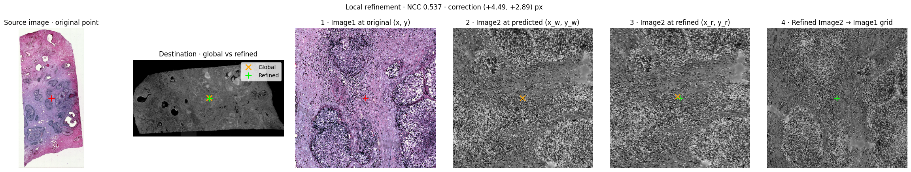

# MicroMorphAlign

**Global registration gets you close. Local tissue structure gets you closer.**



MicroMorphAlign is a training-free, bidirectional **point correspondence refinement**
layer for paired microscopy images. It builds on the original MorphAlign
affine registration workflow (the required MorphAlign v2
source modules are vendored in `morphalign/`; no external MorphAlign installation
is needed). The API accepts grayscale and arbitrary-channel images, including
H&E, autofluorescence and DAPI.

> **Status:** research prototype. A high matching score does not prove two
> patches depict the identical cell; repeated patterns and missing marker
> expression can produce false matches. Validate against manually verified
> landmarks before interpreting point-level measurements biologically.

## What it does

1. MorphAlign estimates a global affine `M12` mapping original **image1 (x,y)**
   to original **image2 (x,y)**. Supply an existing registration or let the
   matcher compute one using Sobol exploration and Adam optimization.
2. MicroMorphAlign resamples the **source image's structural features into the
   destination grid**. Thus `context_window` means the same scale in both
   patches, even if the original images have different image dimensions,
   rotations or anisotropic scales.
3. For a source coordinate, find the best candidate within `search_radius`
   pixels of the global prediction using normalized cross-correlation (NCC)
   on nuclear/edge features. Estimate subpixel translation via a 3-point
   quadratic peak fit. Retain the local score map and competing-peak margin.
4. To go in reverse (`image2 → image1`), invert `M12` and repeat the local
   comparison in image1's grid. Optional round-trip consistency reports how
   close the reverse correspondence returns to the starting point.

## Install

```bash
git clone [microMorphAlign](https://github.com/lkhangkv1995/microMorphAlign)
cd microMorphAlign
pip install -e ".[notebook,test]"
jupyter lab notebooks/demo.ipynb
```

The repository includes the required original MorphAlign v2 Python modules,
licensed under MIT, together with small example TIFFs.

## Python usage

```python
from micromorphalign import read_image, register, MicroMorphAlign, plot_match
import matplotlib.pyplot as plt

image1 = read_image("examples/image1.tiff")
image2 = read_image("examples/image2.tiff")

# This is an expensive *one-time* global optimization.
global_result = register(image1, image2, deformable=False,
                         channels="auto", sobol_samples=256,
                         exploration_rounds=2)

matcher = MicroMorphAlign(image1, image2, registration=global_result)

# A point in the original image1 coordinate system.
forward = matcher.map_point((500, 250), direction="1to2",
                            context_window=81, search_radius=20,
                            check_cycle=True)
print("Predicted image2 xy:", forward["predicted"])
print("Refined image2 xy:", forward["refined"])
print("NCC:", forward["score"])
print("Cycle error (image1 pixels):", forward["cycle_error_px"])

# A point in original image2 coordinates, using the SAME global fit.
reverse = matcher.map_point((520, 260), direction="2to1",
                            context_window=81, search_radius=20)
print("Refined image1 xy:", reverse["refined"])

fig = plot_match(matcher, forward)
plt.show()
```

The figure contains the original source point, destination markers, and four
**raw-image** patch panels: (1) source image at the original coordinate,
(2) destination image at the globally predicted coordinate, (3) destination
image at the locally refined coordinate, and (4) the refined destination patch
resampled through the global affine plus local shift into the source image grid.
Panels 2–3 share the destination scale; panels 1 and 4 share the source scale.
NCC remains a numeric diagnostic, not a displayed search-landscape heatmap.

For an already-known affine matrix, skip registration entirely:

```python
matcher = MicroMorphAlign(image1, image2, matrix12=your_3_by_3_affine)
```

You can pass custom 2D feature maps via `feature1=...`, `feature2=...` or
switch to `feature_mode="edges"` if modality-dependent intensity features
are unreliable. A single matcher caches transformed feature maps and supports
`matcher.map_points([...], direction="1to2")` for batches.

### Coordinate conventions

| Item | Meaning |
| --- | --- |
| `image1`, `image2` | Original pixel arrays, `H×W` or `H×W×C` |
| `(x, y)` | Zero-based *pixel-center* coordinates, not `(row, column)` |
| `matrix12` | Homogeneous map `image1 → image2` |
| `direction="1to2"` | Input point in original image1; return point in original image2 |
| `direction="2to1"` | Input point in original image2; return point in original image1 |
| `context_window` | Odd square patch width in **destination pixels** |
| `search_radius` | Maximum translation search in **destination pixels** |
| `score` | Best normalized cross-correlation (closer to 1 is better) |
| `peak_margin` | Best NCC minus highest non-neighboring candidate NCC |
| `cycle_error_px` | Reverse round-trip discrepancy in starting-image pixels |

## Limitations and proposed next steps

- **Affine coordinate mapping only.** If a supplied MorphAlign registration has
  a deformable field, MicroMorphAlign currently uses its affine component;
  it does *not* trace coordinates through that field. The API warns about this.
- **Translation residuals only.** Within the context window, local rotation,
  scale or true tissue deformation may require a different descriptor and a
  local deformation model. The source is globally resampled onto the target
  grid before matching, so initial affine scale differences are handled.
- **Patch confidence isn't ground truth.** NCC and cycle consistency are
  diagnostics, not calibrated probabilities. Validate against human-verified
  correspondences and reject low-contrast/cropped patches.
- **Fluorescence marker heterogeneity.** Shared nuclear or boundary signals
  are ideal; channels expressing fundamentally different biology may not have
  a reliable pixel-level match. Custom feature maps are supported.
- Global registration uses PyTorch; local patch matching uses OpenCV.

## Layout

```text
microMorphAlign/
├── micromorphalign/         # Point-refinement API, features, figures
├── morphalign/              # Vendored MorphAlign v2 global registration
├── notebooks/demo.ipynb    # Two-way interactive workflow
├── examples/               # Paired example TIFFs
├── tests/                  # Synthetic affine and residual benchmarks
├── pyproject.toml
└── LICENSE
```

## Acknowledgment and license

MicroMorphAlign contains source modules adapted from the MorphAlign v2 code
developed in this project. It is distributed under the MIT license; see
`LICENSE`. Please retain attribution if publishing modifications.
